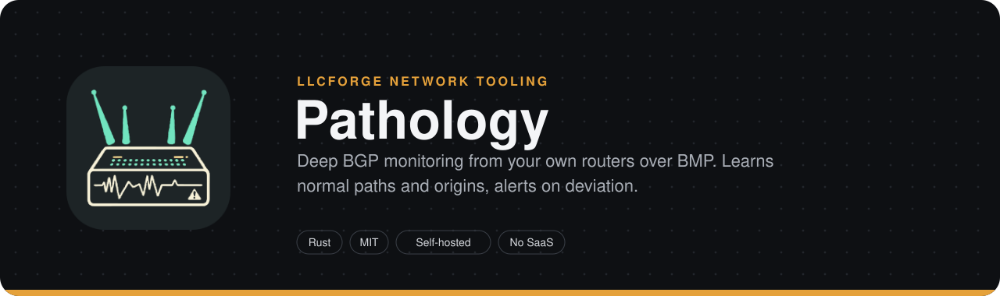
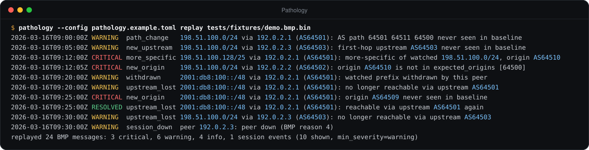
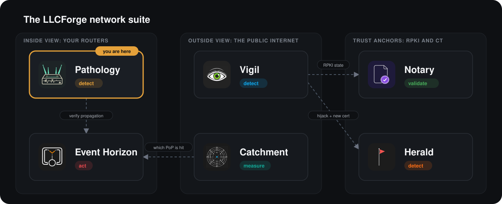

> **LLCForge network tooling** — self-hosted, Rust, no SaaS.
> **Pathology** · [Event Horizon](https://github.com/LLCForge/Event-Horizon) · [Catchment](https://github.com/LLCForge/Catchment) · [Notary](https://github.com/LLCForge/Notary) · [Herald](https://github.com/LLCForge/Herald) · [Vigil](https://github.com/LLCForge/Vigil)

<!-- readme-visuals -->
<p align="center">
  
</p>

<p align="center">BGP route monitor for your own routers and BMP feeds. Learns the AS paths and origins your prefixes normally use, then alerts on any deviation.</p>

<p align="center">
  <strong>English</strong> · <a href="README.tr.md">Türkçe</a>
</p>

<p align="center">
  <a href="LICENSE"></a>
  
  
</p>

---

## Why

Public route collectors only see what reaches them, minutes late and from a handful of vantage points. Your own routers see every path, every upstream and every attribute change the moment it happens. Pathology turns that full-fidelity view into a learned baseline and tells you when reality stops matching it.

## Demo

<p align="center">
  
</p>

<sub>Real output of `pathology --config pathology.example.toml replay tests/fixtures/demo.bmp.bin` on sample data that uses documentation address ranges and private ASNs (long lines shortened).</sub>

## Features

**Collectors**
- **BMP collector (RFC 7854)** on TCP `0.0.0.0:11019`: Initiation, Peer Up/Down, Route Monitoring, Statistics and Termination. Only routers in `allowed_peers` may connect; a reconnecting router replaces its old session.
- **BMP Loc-RIB (RFC 9069)**: the router's own best paths (peer type 3) are tracked as `loc-rib` of that router. Adj-RIB-Out messages (RFC 8671 O-flag) are ignored.
- **Passive BGP listener** for routers without BMP: a receive-only session (OPEN with 4-byte AS, MP IPv4/IPv6 unicast and ADD-PATH receive, KEEPALIVEs, hold timer). Pathology never sends an UPDATE. Only configured peer addresses with the configured ASN are accepted.
- **BGP decoding**: IPv4 and MP-BGP IPv4/IPv6 unicast NLRI, `ORIGIN`, `AS_PATH` (4-byte, sets, confederations), **`AS4_PATH` merging for 2-byte speakers (RFC 6793)**, **ADD-PATH path identifiers (RFC 7911)** negotiated from the BMP Peer Up OPENs or the BGP OPEN exchange, `COMMUNITIES` and **`LARGE_COMMUNITY` (RFC 8092)**. OPEN capabilities including RFC 9072 extended optional parameters.
- **Defensive parsing**: every length field is bounds-checked, messages are size-capped before allocation, no `unsafe` (`#![forbid(unsafe_code)]`). A malformed message closes only that session.

**Detection** (typed findings, severities `info` / `warning` / `critical`)
- `new_origin` (also any origin outside `expected_origins`), `new_upstream`, `path_change`, `more_specific`, `withdrawn`.
- `prepend_change` (same path with different prepending) and `path_length_change` (length differs from every baseline length by `path_length_delta` or more).
- `community_change`: a standard or large community the watched prefix never carried before.
- `route_leak`: valley-free violation (RFC 7908) checked against a CAIDA `as-rel` relationship file, with your own ASN as the receiver.
- `upstream_lost`: the prefix is no longer reachable via a first-hop upstream it used; resolved automatically when the upstream returns.
- `session_down` (BMP router feed, BMP peer, passive BGP session; resolved when it comes back) and `peer_flap` (N downs inside a window).
- **RPKI state on every finding** through [Notary](https://github.com/LLCForge/Notary) (`valid`, `invalid`, `not_found`, plus `stale`): optional, cached, time-boxed; a missing Notary never blocks an alert.
- Baseline-based findings are downgraded to `info` while the baseline is learning; `expected_origins` violations never are.

**Baseline**
- Per watched prefix: weighted histograms of origins, upstreams, full paths, path lengths and communities in `<data_dir>/baseline.json` (atomic temp-file + rename; version 1 files load unchanged).
- **Decay**: with `baseline.half_life` the weights halve every half-life and keys below 0.125 are forgotten, so paths unused for long stop counting as known.
- **MRT import**: `pathology import-mrt` seeds the baseline from TABLE_DUMP_V2 RIB dumps (including RFC 8050 ADD-PATH subtypes) and BGP4MP / BGP4MP_ET update files; `.gz` is read directly.

**Route API and web UI** (read-only, default `127.0.0.1:8180`)
- `GET /v1/routes?prefix=<p>&since=<rfc3339>&limit=<n>`: persisted announce/withdraw history (prefix and more-specifics), retention-bounded.
- `GET /v1/prefixes/<p>/paths`: the current best path per router/peer.
- `GET /v1/origins?asn=<n>`: prefixes currently originated by that AS as seen by your routers.
- `GET /`: embedded web UI (no CDN, no external requests) with a per-prefix AS path graph, current paths and recent events.
- Optional bearer token, security headers (strict CSP, `nosniff`, `DENY` framing), concurrency limit, request timeout, no request bodies.

**Operations** (shared [llcforge-alert](crates/llcforge-alert) kit)
- Alerts in the `llcforge.alert.v1` schema to stdout, webhook (HMAC-signed), Telegram, Slack, Discord, Microsoft Teams, e-mail (SMTP), PagerDuty, Opsgenie and syslog; per-sink severity / kind / resource filters, retries with backoff, rate limits.
- Crash-safe persistent alert queue with redelivery, deduplication by stable alert id, resolved alerts.
- Silences / maintenance windows: `pathology silence add|list|remove` and `/v1/silences`.
- `/healthz`, `/readyz` and `/metrics` (Pathology and alert-pipeline metrics) on the management listener; Grafana dashboard and Prometheus rules in `deploy/`.
- Configuration reload on `SIGHUP` (Unix), on config file change (all OSes) or `POST /v1/reload`.
- Text or JSON logging; `pathology service install|uninstall|run` (Windows service; systemd / launchd units for Linux / macOS).
- **Offline replay**: `pathology replay <file>` runs a raw BMP capture through the detector without a router.

## Where it fits in the suite


**Pathology vs. [Vigil](https://github.com/LLCForge/Vigil):** both catch hijacks, but from opposite ends. Pathology is *deep* monitoring from **your own infrastructure** (BMP / BGP sessions): full paths, upstreams, communities, learned baselines. Vigil is *fast, shallow* detection from **public feeds** (RIPE RIS, RouteViews): it only asks "who is originating my prefix right now?" and needs no router access. Run Pathology for path-level insight inside your network; run Vigil to see what the rest of the Internet sees. They complement each other and do not duplicate work.

<p align="center">
  
</p>

## Quick start

> **Status:** pre-release. Configuration keys and CLI flags may change before 1.0.

Requirements: a recent stable Rust toolchain, 1.85 or newer ([rustup.rs](https://rustup.rs)). No system libraries are needed (TLS uses rustls). Builds and runs on Linux, macOS and Windows.

```bash
git clone https://github.com/LLCForge/Pathology.git
cd Pathology
cargo build --release

# Try it without a router: replay the bundled demo capture
./target/release/pathology --config pathology.example.toml replay tests/fixtures/demo.bmp.bin

# Real deployment: copy the example, edit routers and prefixes, then run
cp pathology.example.toml pathology.toml
./target/release/pathology --config pathology.toml check
./target/release/pathology --config pathology.toml run
```

Point your router's BMP station at the host on port 11019, or configure a BGP neighbor towards the passive listener. Then open `http://127.0.0.1:8180/` for the web UI.

Minimal `pathology.toml` (documentation addresses; see [`pathology.example.toml`](pathology.example.toml) for every key):

```toml
[collector.bmp]
listen = "0.0.0.0:11019"
allowed_peers = ["192.0.2.1", "192.0.2.2"]   # only these routers may connect

[[watch]]
prefix = "198.51.100.0/24"
expected_origins = [64500]

[[alerts.sink]]
type = "telegram"
bot_token_env = "TELEGRAM_BOT_TOKEN"
chat_id = -1001234567890
min_severity = "warning"

[metrics]
listen = "127.0.0.1:9419"
```

Passive BGP instead of (or next to) BMP:

```toml
[collector.bgp]
listen = "0.0.0.0:179"
local_asn = 64496
router_id = "192.0.2.254"
[[collector.bgp.peer]]
address = "192.0.2.3"
asn = 64503
```

Secrets (bot tokens, webhook secrets, API tokens) are always read from environment variables named by the `*_env` keys, never from the config file. Durations accept `s`, `m`, `h` and `d` suffixes.

> **Upgrading from the first release:** the old `[alerts] min_severity / webhook / telegram` keys are replaced by `[[alerts.sink]]` entries (with a per-sink `min_severity`); `pathology check` reports the offending key. `storage.data_dir` now defaults to the platform data directory.

## Installation

| Platform | Package | Service |
|---|---|---|
| Debian / Ubuntu | `.deb` from the release page (`cargo deb`) | `sudo systemctl enable --now pathology` (unit installed, not enabled) |
| RHEL / Fedora | `.rpm` from the release page (`cargo generate-rpm`) | same systemd unit |
| macOS | `brew install` with [`packaging/homebrew/pathology.rb`](packaging/homebrew/pathology.rb) | launchd: [`packaging/launchd/net.llcforge.pathology.plist`](packaging/launchd/net.llcforge.pathology.plist) |
| Windows | `scoop install` with [`packaging/scoop/pathology.json`](packaging/scoop/pathology.json) or the winget manifests in [`packaging/winget`](packaging/winget) | `pathology --config C:\ProgramData\LLCForge\pathology\pathology.toml service install` (Administrator) |
| Docker | `docker compose up -d` ([`docker-compose.yml`](docker-compose.yml), distroless, non-root) | container |
| Kubernetes | `helm install pathology deploy/helm/pathology` | Deployment + PVC |

- **Linux**: the packaged unit runs with `DynamicUser=yes` and state in `/var/lib/pathology` (`$STATE_DIRECTORY`). Put secrets in `/etc/pathology/pathology.env` (mode 0600). `systemctl reload pathology` sends `SIGHUP` (configuration reload). For a passive BGP listener on port 179 add `AmbientCapabilities=CAP_NET_BIND_SERVICE` and `CapabilityBoundingSet=CAP_NET_BIND_SERVICE` in a drop-in, or listen on a port above 1023.
- **macOS**: `pathology service install` prints the launchd steps. Binding port 179 works unprivileged on macOS 10.14 and later.
- **Windows**: `service install` registers a Windows service that runs `pathology service run --config <path>`; `service uninstall` removes it. Data lives in `%ProgramData%\LLCForge\pathology`. Port 179 needs no special privilege; allow the listener in Windows Defender Firewall.
- **Docker / Helm**: set the management listener and `api.listen` to `0.0.0.0` inside the container; probes use `/healthz` and `/readyz` on port 9419. The chart exposes BMP (11019) and the API (8180).

Grafana dashboard: [`deploy/grafana/pathology-dashboard.json`](deploy/grafana/pathology-dashboard.json); alert rules: [`deploy/prometheus/pathology-rules.yml`](deploy/prometheus/pathology-rules.yml).

## Usage

```text
pathology [--config <FILE>] [run]                run collectors, detector, API and alerting (default)
pathology [--config <FILE>] check                validate config and every referenced secret, then exit
pathology [--config <FILE>] replay <FILE> [--all]  replay a raw BMP capture offline (--all: include info)
pathology [--config <FILE>] import-mrt <FILE>...  seed the baseline from MRT dumps (.gz accepted)
pathology [--config <FILE>] silence add|list|remove
pathology [--config <FILE>] service install|uninstall|run
pathology --version
```

`--config` defaults to `pathology.toml`. Replay uses the watch list and detection settings from the config but always starts from an empty in-memory baseline, uses the router timestamps from the capture as its clock, and never sends alerts or writes state. A capture is the raw TCP byte stream a router sends to its BMP station, for example recorded with `nc -l 11019 > capture.bin`. Stop the service before `import-mrt`: it rewrites `baseline.json`. bzip2 dumps (RouteViews) must be decompressed first (`bunzip2 -k`).

Example output of the demo replay:

```text
2026-03-16T09:00:00Z WARNING  path_change   198.51.100.0/24 via 192.0.2.1 (AS64501): AS path 64501 64511 64500 never seen in baseline
2026-03-16T09:05:00Z WARNING  new_upstream  198.51.100.0/24 via 192.0.2.3 (AS64503): first-hop upstream AS64503 never seen in baseline (path 64503 64500)
2026-03-16T09:12:00Z CRITICAL more_specific 198.51.100.128/25 via 192.0.2.1 (AS64501): more-specific of watched 198.51.100.0/24 announced, origin AS64510 (path 64501 64510)
2026-03-16T09:12:05Z CRITICAL new_origin    198.51.100.0/24 via 192.0.2.2 (AS64502): origin AS64510 is not in expected_origins [64500] (path 64502 64510)
2026-03-16T09:20:00Z WARNING  withdrawn     2001:db8:100::/48 via 192.0.2.1 (AS64501): watched prefix withdrawn by this peer
2026-03-16T09:20:00Z WARNING  upstream_lost 2001:db8:100::/48 via 192.0.2.1 (AS64501): no longer reachable via upstream AS64501
2026-03-16T09:25:00Z CRITICAL new_origin    2001:db8:100::/48 via 192.0.2.1 (AS64501): origin AS64509 never seen in baseline (path 64501 64509)
2026-03-16T09:25:00Z RESOLVED upstream_lost 2001:db8:100::/48 via 192.0.2.1 (AS64501): reachable via upstream AS64501 again
2026-03-16T09:30:00Z WARNING  upstream_lost 198.51.100.0/24 via 192.0.2.3 (AS64503): no longer reachable via upstream AS64503
2026-03-16T09:30:00Z WARNING  session_down  peer 192.0.2.3: peer down (BMP reason 4)
replayed 24 BMP messages: 3 critical, 6 warning, 4 info, 1 session events (10 shown, min_severity=warning)
```

Route API (add `-H "Authorization: Bearer $PATHOLOGY_API_TOKEN"` when `api.token_env` is set):

```bash
curl -s 'http://127.0.0.1:8180/v1/prefixes/198.51.100.0/24/paths'
curl -s 'http://127.0.0.1:8180/v1/routes?prefix=198.51.100.0/24&since=2026-03-16T09:00:00Z&limit=50'
curl -s 'http://127.0.0.1:8180/v1/origins?asn=64500'
```

`/v1/routes` returns events oldest first: those at or after `since` (first `limit`), or the latest `limit` events without `since` (`limit` defaults to 100, maximum 1000). `/v1/prefixes/<p>/paths` picks, per router and peer, the shortest AS path (ADD-PATH peers send several). Management endpoints: `curl -s http://127.0.0.1:9419/metrics`, `/healthz`, `/readyz`.

## Roadmap

Everything listed under Features is implemented and tested. Known gaps:

- **TCP-MD5 (RFC 2385)** on the passive BGP listener is not supported; configure the session without a password (or protect it with ACLs / GTSM on the router).
- The passive listener only accepts sessions (it never connects out) and resolves a connection collision by replacing the older session instead of RFC 4271 collision detection.
- A malformed UPDATE resets the session; RFC 7606 treat-as-withdraw is not implemented.
- Route leak detection is only as accurate as the relationship file; ASPA (draft-ietf-sidrops-aspa-verification) is not used here (see Notary).
- MRT: legacy `TABLE_DUMP` (v1), `RIB_GENERIC` and bzip2 input are not read directly.
- BMP Route Mirroring messages are not decoded; Adj-RIB-Out monitoring is skipped.
- Interoperability has been tested with synthetic BMP / BGP / MRT data and the in-repo encoders, not yet against every router vendor.

## How it works

See [ARCHITECTURE.md](ARCHITECTURE.md) for components, data flow, trust boundaries and failure modes.

## Related tools

- [Vigil](https://github.com/LLCForge/Vigil): Real-time origin hijack detection over public RIPE RIS and RouteViews feeds. Flags the moment someone else announces your prefix.
- [Notary](https://github.com/LLCForge/Notary): RPKI Route Origin Validation checker. Pathology attaches its verdict to every finding; Notary can read your announced prefixes from Pathology's `/v1/origins`.
- [Catchment](https://github.com/LLCForge/Catchment): anycast catchment monitor; on a catchment shift it fetches path changes from Pathology's `/v1/routes`.
- [Event Horizon](https://github.com/LLCForge/Event-Horizon): Automated RTBH in Rust. On DDoS detection it announces the victim prefix as a blackhole and sends the BGP community upstream.

## Contributing

Issues and pull requests are welcome. Read [CONTRIBUTING.md](CONTRIBUTING.md) and the [Code of Conduct](CODE_OF_CONDUCT.md) first. Found a vulnerability? Do **not** open a public issue; follow [SECURITY.md](SECURITY.md).

## License

Pathology is free and open-source software released under the [MIT License](LICENSE). See [NOTICE](NOTICE) for attributions.
