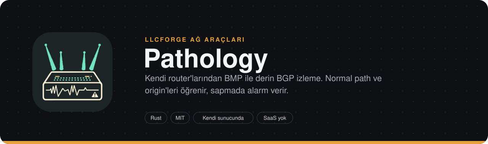
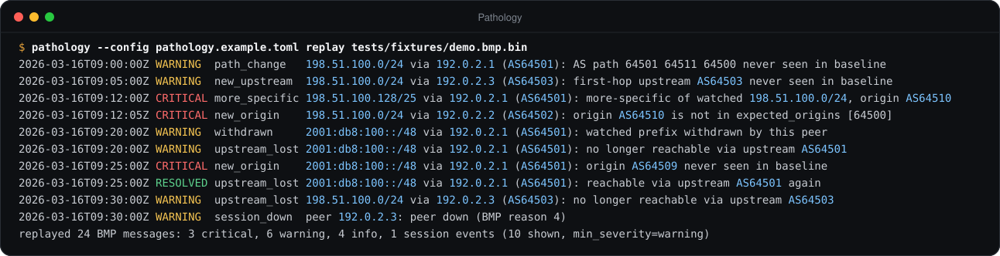
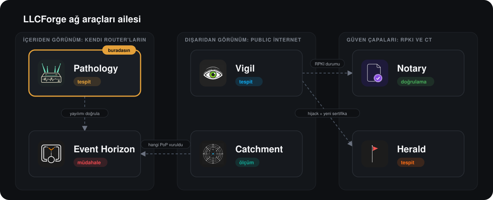

> **LLCForge ağ araçları** — kendi sunucunda, Rust, SaaS yok.
> **Pathology** · [Event Horizon](https://github.com/LLCForge/Event-Horizon) · [Catchment](https://github.com/LLCForge/Catchment) · [Notary](https://github.com/LLCForge/Notary) · [Herald](https://github.com/LLCForge/Herald) · [Vigil](https://github.com/LLCForge/Vigil)

<!-- readme-visuals -->
<p align="center">
  
</p>

<p align="center">Kendi router'ların ve BMP beslemelerin için BGP rota izleyici. Prefix'lerinin normalde kullandığı AS path'leri ve origin'leri öğrenir, en küçük sapmada alarm verir.</p>

<p align="center">
  <a href="README.md">English</a> · <strong>Türkçe</strong>
</p>

<p align="center">
  <a href="LICENSE"></a>
  
  
</p>

---

## Neden

Public route collector'lar yalnızca kendilerine ulaşanı, dakikalar gecikmeyle ve sınırlı sayıda gözlem noktasından görür. Senin router'ların ise her path'i, her upstream'i ve her attribute değişikliğini anında görür. Pathology bu tam çözünürlüklü görünümü öğrenilmiş bir baseline'a çevirir ve gerçeklik bu baseline'dan saptığında seni uyarır.

## Örnek çıktı

<p align="center">
  
</p>

<sub>`pathology --config pathology.example.toml replay tests/fixtures/demo.bmp.bin` komutunun, dokümantasyon adres aralıkları ve özel ASN'ler kullanan örnek veri üzerindeki gerçek çıktısı (uzun satırlar kısaltıldı).</sub>

## Özellikler

**Toplayıcılar**
- **BMP toplayıcı (RFC 7854)**, TCP `0.0.0.0:11019` üzerinde: Initiation, Peer Up/Down, Route Monitoring, Statistics ve Termination. Yalnızca `allowed_peers` listesindeki router'lar bağlanabilir; yeniden bağlanan router eski oturumunun yerini alır.
- **BMP Loc-RIB (RFC 9069)**: router'ın kendi en iyi path'leri (peer tipi 3), o router'ın `loc-rib` kaynağı olarak izlenir. Adj-RIB-Out mesajları (RFC 8671 O-bayrağı) yok sayılır.
- BMP desteği olmayan router'lar için **pasif BGP dinleyici**: yalnızca alım yapan oturum (4 baytlık AS, MP IPv4/IPv6 unicast ve ADD-PATH alımı içeren OPEN, KEEPALIVE'lar, hold timer). Pathology hiçbir zaman UPDATE göndermez. Yalnızca yapılandırılmış peer adresleri, yapılandırılmış ASN ile kabul edilir.
- **BGP çözümleme**: IPv4 ve MP-BGP IPv4/IPv6 unicast NLRI, `ORIGIN`, `AS_PATH` (4 bayt, set'ler, konfederasyonlar), **2 baytlık konuşmacılar için `AS4_PATH` birleştirme (RFC 6793)**, BMP Peer Up OPEN'larından ya da BGP OPEN alışverişinden müzakere edilen **ADD-PATH path kimlikleri (RFC 7911)**, `COMMUNITIES` ve **`LARGE_COMMUNITY` (RFC 8092)**. RFC 9072 genişletilmiş opsiyonel parametreler dahil OPEN capability'leri.
- **Savunmacı ayrıştırma**: her uzunluk alanı sınır denetiminden geçer, mesajlar bellek ayrılmadan önce boyutla sınırlanır, `unsafe` yoktur (`#![forbid(unsafe_code)]`). Bozuk bir mesaj yalnızca o oturumu kapatır.

**Tespit** (tipli bulgular, önem seviyeleri `info` / `warning` / `critical`)
- `new_origin` (`expected_origins` dışındaki her origin dahil), `new_upstream`, `path_change`, `more_specific`, `withdrawn`.
- `prepend_change` (aynı path, farklı prepend) ve `path_length_change` (uzunluk, baseline'daki her uzunluktan en az `path_length_delta` kadar farklı).
- `community_change`: izlenen prefix'in daha önce hiç taşımadığı standart ya da large community.
- `route_leak`: CAIDA `as-rel` ilişki dosyasına göre valley-free ihlali (RFC 7908); alıcı olarak senin ASN'in kullanılır.
- `upstream_lost`: prefix'e artık kullandığı bir ilk hop upstream üzerinden ulaşılamıyor; upstream geri geldiğinde otomatik olarak çözülür.
- `session_down` (BMP router beslemesi, BMP peer'ı, pasif BGP oturumu; geri geldiğinde çözülür) ve `peer_flap` (bir pencere içinde N kez düşme).
- [Notary](https://github.com/LLCForge/Notary) üzerinden **her bulguda RPKI durumu** (`valid`, `invalid`, `not_found` ve `stale`): isteğe bağlı, önbellekli, süre sınırlı; Notary'nin olmaması bir alarmı asla bekletmez.
- Baseline'a dayalı bulgular, baseline öğrenirken `info` seviyesine düşürülür; `expected_origins` ihlalleri asla düşürülmez.

**Baseline**
- İzlenen her prefix için origin, upstream, tam path, path uzunluğu ve community'lerin ağırlıklı histogramları; `<data_dir>/baseline.json` dosyasına atomik olarak yazılır (geçici dosya + rename; sürüm 1 dosyaları olduğu gibi yüklenir).
- **Sönümleme**: `baseline.half_life` ile ağırlıklar her yarı ömürde yarıya iner ve 0,125'in altına düşen anahtarlar unutulur; uzun süredir kullanılmayan path'ler artık bilinen sayılmaz.
- **MRT içe aktarma**: `pathology import-mrt`, baseline'ı TABLE_DUMP_V2 RIB dökümlerinden (RFC 8050 ADD-PATH alt tipleri dahil) ve BGP4MP / BGP4MP_ET güncelleme dosyalarından besler; `.gz` doğrudan okunur.

**Rota API'si ve web arayüzü** (salt okunur, varsayılan `127.0.0.1:8180`)
- `GET /v1/routes?prefix=<p>&since=<rfc3339>&limit=<n>`: kalıcı anons/withdraw geçmişi (prefix ve more-specific'leri), saklama süresiyle sınırlı.
- `GET /v1/prefixes/<p>/paths`: her router/peer için güncel en iyi path.
- `GET /v1/origins?asn=<n>`: router'larının gördüğü haliyle o AS'in şu an origin ettiği prefix'ler.
- `GET /`: gömülü web arayüzü (CDN yok, dış istek yok); prefix başına AS path grafiği, güncel path'ler ve son olaylar.
- İsteğe bağlı bearer token, güvenlik başlıkları (sıkı CSP, `nosniff`, `DENY` frame), eşzamanlılık sınırı, istek zaman aşımı, gövdesiz istekler.

**İşletim** (ortak [llcforge-beacon](crates/llcforge-beacon) kiti)
- `llcforge.alert.v1` şemasında alarmlar: stdout, webhook (HMAC imzalı), Telegram, Slack, Discord, Microsoft Teams, e-posta (SMTP), PagerDuty, Opsgenie ve syslog; kanal başına önem / tür / kaynak filtreleri, geri çekilmeli yeniden deneme, hız sınırları.
- Çökmeye dayanıklı kalıcı alarm kuyruğu ve yeniden teslim, sabit alarm kimliğiyle tekilleştirme, çözüldü alarmları.
- Susturmalar / bakım pencereleri: `pathology silence add|list|remove` ve `/v1/silences`.
- Yönetim dinleyicisinde `/healthz`, `/readyz` ve `/metrics` (Pathology ve alarm hattı metrikleri); `deploy/` altında Grafana panosu ve Prometheus kuralları.
- `SIGHUP` (Unix), yapılandırma dosyası değişikliği (tüm işletim sistemleri) veya `POST /v1/reload` ile yapılandırmayı yeniden yükleme.
- Metin veya JSON log; `pathology service install|uninstall|run` (Windows hizmeti; Linux / macOS için systemd / launchd dosyaları).
- **Çevrimdışı replay**: `pathology replay <dosya>` ham bir BMP kaydını router olmadan detektörden geçirir.

## Ailedeki yeri


**Pathology ve [Vigil](https://github.com/LLCForge/Vigil) farkı:** ikisi de hijack yakalar ama zıt uçlardan. Pathology, **kendi altyapından** (BMP / BGP oturumları) *derin* izleme yapar: tam path'ler, upstream'ler, community'ler, öğrenilmiş baseline'lar. Vigil ise **public feed'lerden** (RIPE RIS, RouteViews) *hızlı ve sığ* tespit yapar: yalnızca "şu an prefix'imi kim origin ediyor?" sorusunu sorar ve router erişimi gerektirmez. Ağının içinde path seviyesinde görünürlük için Pathology'yi, İnternet'in geri kalanının ne gördüğünü bilmek için Vigil'i çalıştır. Birbirlerini tamamlarlar, aynı işi iki kez yapmazlar.

<p align="center">
  
</p>

## Hızlı başlangıç

> **Durum:** yayın öncesi. Yapılandırma anahtarları ve CLI parametreleri 1.0'dan önce değişebilir.

Gereksinim: güncel bir kararlı Rust araç zinciri, 1.88 veya üstü ([rustup.rs](https://rustup.rs)). Sistem kütüphanesi gerekmez (TLS için rustls kullanılır). Linux, macOS ve Windows'ta derlenir ve çalışır.

```bash
git clone https://github.com/LLCForge/Pathology.git
cd Pathology
cargo build --release

# Router olmadan dene: paketle gelen demo kaydını oynat
./target/release/pathology --config pathology.example.toml replay tests/fixtures/demo.bmp.bin

# Gerçek kurulum: örneği kopyala, router'ları ve prefix'leri düzenle, çalıştır
cp pathology.example.toml pathology.toml
./target/release/pathology --config pathology.toml check
./target/release/pathology --config pathology.toml run
```

Router'ının BMP istasyonunu bu makinenin 11019 portuna yönlendir ya da pasif dinleyiciye doğru bir BGP komşusu tanımla. Ardından web arayüzü için `http://127.0.0.1:8180/` adresini aç.

En küçük `pathology.toml` (dokümantasyon adresleri; tüm anahtarlar için [`pathology.example.toml`](pathology.example.toml) dosyasına bak):

```toml
[collector.bmp]
listen = "0.0.0.0:11019"
allowed_peers = ["192.0.2.1", "192.0.2.2"]   # yalnızca bu router'lar bağlanabilir

[[watch]]
prefix = "198.51.100.0/24"
expected_origins = [64500]

[[alerts.sink]]
type = "telegram"
bot_token_env = "TELEGRAM_BOT_TOKEN"
chat_id = -1001234567890
min_severity = "warning"

[metrics]
listen = "127.0.0.1:9419"
```

BMP yerine (ya da yanında) pasif BGP:

```toml
[collector.bgp]
listen = "0.0.0.0:179"
local_asn = 64496
router_id = "192.0.2.254"
[[collector.bgp.peer]]
address = "192.0.2.3"
asn = 64503
```

Gizli bilgiler (bot token'ları, webhook gizli anahtarları, API token'ları) her zaman `*_env` anahtarlarında adı verilen ortam değişkenlerinden okunur, asla yapılandırma dosyasından okunmaz. Süreler `s`, `m`, `h` ve `d` sonekleriyle yazılır.

> **İlk sürümden yükseltme:** eski `[alerts] min_severity / webhook / telegram` anahtarlarının yerini `[[alerts.sink]]` girdileri (kanal başına `min_severity` ile) aldı; `pathology check` hatalı anahtarı bildirir. `storage.data_dir` artık varsayılan olarak platformun veri dizinini kullanır.

## Kurulum

| Platform | Paket | Hizmet |
|---|---|---|
| Debian / Ubuntu | Sürüm sayfasından `.deb` (`cargo deb`) | `sudo systemctl enable --now pathology` (unit kurulur, etkinleştirilmez) |
| RHEL / Fedora | Sürüm sayfasından `.rpm` (`cargo generate-rpm`) | aynı systemd unit'i |
| macOS | [`packaging/homebrew/pathology.rb`](packaging/homebrew/pathology.rb) ile `brew install` | launchd: [`packaging/launchd/net.llcforge.pathology.plist`](packaging/launchd/net.llcforge.pathology.plist) |
| Windows | [`packaging/scoop/pathology.json`](packaging/scoop/pathology.json) ile `scoop install` ya da [`packaging/winget`](packaging/winget) içindeki winget manifestleri | `pathology --config C:\ProgramData\LLCForge\pathology\pathology.toml service install` (Yönetici) |
| Docker | `docker compose up -d` ([`docker-compose.yml`](docker-compose.yml), distroless, root olmayan kullanıcı) | konteyner |
| Kubernetes | `helm install pathology deploy/helm/pathology` | Deployment + PVC |

- **Linux**: paketle gelen unit `DynamicUser=yes` ile ve durum `/var/lib/pathology` (`$STATE_DIRECTORY`) altında çalışır. Gizli bilgileri `/etc/pathology/pathology.env` dosyasına koy (mod 0600). `systemctl reload pathology` bir `SIGHUP` gönderir (yapılandırma yeniden yüklenir). 179 portunda pasif BGP dinleyici için bir drop-in dosyasına `AmbientCapabilities=CAP_NET_BIND_SERVICE` ve `CapabilityBoundingSet=CAP_NET_BIND_SERVICE` ekle ya da 1023'ün üstünde bir port kullan.
- **macOS**: `pathology service install` launchd adımlarını yazdırır. macOS 10.14 ve sonrasında 179 portu yetkisiz kullanıcıyla da dinlenebilir.
- **Windows**: `service install`, `pathology service run --config <yol>` komutunu çalıştıran bir Windows hizmeti kaydeder; `service uninstall` bu hizmeti kaldırır. Veriler `%ProgramData%\LLCForge\pathology` altındadır. 179 portu özel yetki gerektirmez; dinleyiciye Windows Defender Güvenlik Duvarı'nda izin ver.
- **Docker / Helm**: konteyner içinde yönetim dinleyicisini ve `api.listen` adresini `0.0.0.0` yap; probe'lar 9419 portunda `/healthz` ve `/readyz` kullanır. Chart, BMP (11019) ve API (8180) portlarını açar.

Grafana panosu: [`deploy/grafana/pathology-dashboard.json`](deploy/grafana/pathology-dashboard.json); alarm kuralları: [`deploy/prometheus/pathology-rules.yml`](deploy/prometheus/pathology-rules.yml).

## Kullanım

```text
pathology [--config <DOSYA>] [run]                 toplayıcılar, detektör, API ve alarmlar (varsayılan)
pathology [--config <DOSYA>] check                 yapılandırmayı ve tüm gizli bilgileri doğrular, çıkar
pathology [--config <DOSYA>] replay <DOSYA> [--all]  ham BMP kaydını çevrimdışı oynatır (--all: info dahil)
pathology [--config <DOSYA>] import-mrt <DOSYA>...  baseline'ı MRT dökümlerinden besler (.gz kabul edilir)
pathology [--config <DOSYA>] silence add|list|remove
pathology [--config <DOSYA>] service install|uninstall|run
pathology --version
```

`--config` varsayılan olarak `pathology.toml` dosyasını kullanır. Replay, izleme listesini ve tespit ayarlarını yapılandırmadan alır; ancak her zaman boş, bellek içi bir baseline ile başlar, saat olarak kayıttaki router zaman damgalarını kullanır, alarm göndermez ve durum yazmaz. Kayıt, router'ın BMP istasyonuna gönderdiği ham TCP bayt akışıdır; örneğin `nc -l 11019 > capture.bin` ile kaydedilebilir. `import-mrt` öncesinde hizmeti durdur: komut `baseline.json` dosyasını yeniden yazar. bzip2 dökümleri (RouteViews) önce açılmalıdır (`bunzip2 -k`).

Demo replay çıktısı örneği:

```text
2026-03-16T09:00:00Z WARNING  path_change   198.51.100.0/24 via 192.0.2.1 (AS64501): AS path 64501 64511 64500 never seen in baseline
2026-03-16T09:05:00Z WARNING  new_upstream  198.51.100.0/24 via 192.0.2.3 (AS64503): first-hop upstream AS64503 never seen in baseline (path 64503 64500)
2026-03-16T09:12:00Z CRITICAL more_specific 198.51.100.128/25 via 192.0.2.1 (AS64501): more-specific of watched 198.51.100.0/24 announced, origin AS64510 (path 64501 64510)
2026-03-16T09:12:05Z CRITICAL new_origin    198.51.100.0/24 via 192.0.2.2 (AS64502): origin AS64510 is not in expected_origins [64500] (path 64502 64510)
2026-03-16T09:20:00Z WARNING  withdrawn     2001:db8:100::/48 via 192.0.2.1 (AS64501): watched prefix withdrawn by this peer
2026-03-16T09:20:00Z WARNING  upstream_lost 2001:db8:100::/48 via 192.0.2.1 (AS64501): no longer reachable via upstream AS64501
2026-03-16T09:25:00Z CRITICAL new_origin    2001:db8:100::/48 via 192.0.2.1 (AS64501): origin AS64509 never seen in baseline (path 64501 64509)
2026-03-16T09:25:00Z RESOLVED upstream_lost 2001:db8:100::/48 via 192.0.2.1 (AS64501): reachable via upstream AS64501 again
2026-03-16T09:30:00Z WARNING  upstream_lost 198.51.100.0/24 via 192.0.2.3 (AS64503): no longer reachable via upstream AS64503
2026-03-16T09:30:00Z WARNING  session_down  peer 192.0.2.3: peer down (BMP reason 4)
replayed 24 BMP messages: 3 critical, 6 warning, 4 info, 1 session events (10 shown, min_severity=warning)
```

Rota API'si (`api.token_env` ayarlıysa `-H "Authorization: Bearer $PATHOLOGY_API_TOKEN"` ekle):

```bash
curl -s 'http://127.0.0.1:8180/v1/prefixes/198.51.100.0/24/paths'
curl -s 'http://127.0.0.1:8180/v1/routes?prefix=198.51.100.0/24&since=2026-03-16T09:00:00Z&limit=50'
curl -s 'http://127.0.0.1:8180/v1/origins?asn=64500'
```

`/v1/routes` olayları eskiden yeniye döndürür: `since` verilirse o andan itibaren ilk `limit` olay, verilmezse son `limit` olay (`limit` varsayılanı 100, en fazla 1000). `/v1/prefixes/<p>/paths`, her router ve peer için en kısa AS path'i seçer (ADD-PATH peer'ları birden fazla path gönderir). Yönetim uç noktaları: `curl -s http://127.0.0.1:9419/metrics`, `/healthz`, `/readyz`.

## Yol haritası

Özellikler bölümündeki her şey uygulanmış ve test edilmiştir. Bilinen eksikler:

- Pasif BGP dinleyicide **TCP-MD5 (RFC 2385)** desteklenmez; oturumu parolasız yapılandır (ya da router tarafında ACL / GTSM ile koru).
- Pasif dinleyici yalnızca bağlantı kabul eder (dışarıya bağlanmaz) ve bağlantı çakışmasını RFC 4271 çakışma tespiti yerine eski oturumu değiştirerek çözer.
- Bozuk bir UPDATE oturumu sıfırlar; RFC 7606 treat-as-withdraw uygulanmamıştır.
- Route leak tespiti ancak ilişki dosyası kadar doğrudur; ASPA (draft-ietf-sidrops-aspa-verification) burada kullanılmaz (bkz. Notary).
- MRT: eski `TABLE_DUMP` (v1), `RIB_GENERIC` ve bzip2 girdisi doğrudan okunmaz.
- BMP Route Mirroring mesajları çözülmez; Adj-RIB-Out izleme atlanır.
- Birlikte çalışabilirlik sentetik BMP / BGP / MRT verisi ve depo içindeki kodlayıcılarla test edildi; henüz her router üreticisine karşı denenmedi.

## Nasıl çalışır

Bileşenler, veri akışı, güven sınırları ve hata senaryoları için [ARCHITECTURE.md](ARCHITECTURE.md) dosyasına bak.

## İlgili araçlar

- [Vigil](https://github.com/LLCForge/Vigil): Public RIPE RIS ve RouteViews feed'leri üzerinden gerçek zamanlı origin hijack tespiti. Başka biri prefix'ini anons ettiği an işaretler.
- [Notary](https://github.com/LLCForge/Notary): RPKI Route Origin Validation denetleyicisi. Pathology her bulguya Notary'nin kararını ekler; Notary de anons ettiğin prefix'leri Pathology'nin `/v1/origins` uç noktasından okuyabilir.
- [Catchment](https://github.com/LLCForge/Catchment): anycast catchment izleyicisi; catchment kaydığında Pathology'nin `/v1/routes` uç noktasından path değişikliklerini çeker.
- [Event Horizon](https://github.com/LLCForge/Event-Horizon): Rust ile otomatik RTBH. DDoS tespit ettiğinde kurban prefix'i blackhole olarak anons eder ve BGP community'sini upstream'e gönderir.

## Katkı

Issue ve pull request'ler memnuniyetle karşılanır. Önce [CONTRIBUTING.md](CONTRIBUTING.md) ve [Davranış Kuralları](CODE_OF_CONDUCT.md) dosyalarını oku. Bir güvenlik açığı mı buldun? Public issue **açma**; [SECURITY.md](SECURITY.md) adımlarını izle.

## Lisans

Pathology, [MIT Lisansı](LICENSE) ile yayınlanan özgür ve açık kaynak bir yazılımdır. Atıflar için [NOTICE](NOTICE) dosyasına bak.
